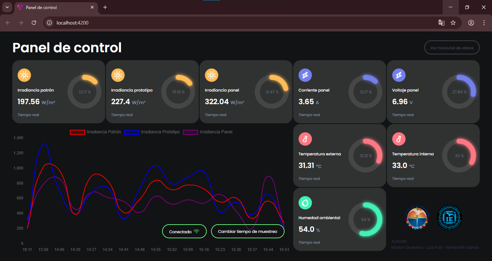

# Irradiance Datalogger Dashboard


Panel web desarrollado en Angular para monitorear las mediciones de un datalogger de irradiancia solar y parámetros ambientales: irradiancia de sensor patrón, del prototipo y del panel, corriente, voltaje, temperatura externa e interna y humedad ambiental. Los datos se leen desde Google Sheets y se actualizan según un intervalo de muestreo configurable.

Proyecto desarrollado en el programa de Ingeniería Electrónica de la Universidad del Magdalena.



## Características

- Tarjetas con el último valor de cada variable medida:

  | Variable | Unidad |
  |---|---|
  | Irradiancia patrón, prototipo y panel | W/m² |
  | Corriente del panel | A |
  | Voltaje del panel | V |
  | Temperatura externa e interna | °C |
  | Humedad ambiental | % |

- Gráfico de las mediciones registradas.
- Intervalo de actualización ajustable desde la interfaz (en minutos).
- Acceso al historial completo de datos.
- Componente de tarjeta reutilizable, configurado por datos (título, unidad, ícono y color).

## Arquitectura

```
Sensores + microcontrolador  →  Google Sheets  →  GoogleSheetsService  →  Componentes Angular
  [COMPLETAR: hardware]          (registro)        (RxJS, polling)        (home, card, gráfico)
```

1. El datalogger registra las mediciones en una hoja de cálculo de Google Sheets.
2. `GoogleSheetsService` consulta la hoja periódicamente y emite los datos mediante un `Observable` de RxJS.
3. `HomeComponent` se suscribe, toma la última fila y actualiza las tarjetas.

## Tecnologías

- Angular (componentes standalone)
- TypeScript
- SCSS
- RxJS
- Google Sheets como fuente de datos

## Estructura del proyecto

```
src/
├── app/
│   ├── components/     # card, gráfico y otros componentes reutilizables
│   ├── pages/          # páginas (home)
│   ├── services/       # GoogleSheetsService
│   ├── app.component.* # componente raíz
│   ├── app.config.ts
│   └── app.routes.ts
├── types/              # tipos de TypeScript
├── index.html
├── main.ts
└── styles.scss
```

## Cómo ejecutarlo

Requisitos: Node.js 18 o superior y Angular CLI.

```bash
git clone https://github.com/lpolobeltran/IrradianceDatalogger.git
cd IrradianceDatalogger
npm install
ng serve
```

La aplicación queda disponible en `http://localhost:4200`.

### Configuración

La aplicación necesita el ID de la hoja de Google Sheets y una clave de API de Google.

## Autores

- Marlon Guerrero
- **Luis Polo Beltrán** · [GitHub](https://github.com/lpolobeltran) · [LinkedIn](COMPLETAR)
- Nohemith Llanos
